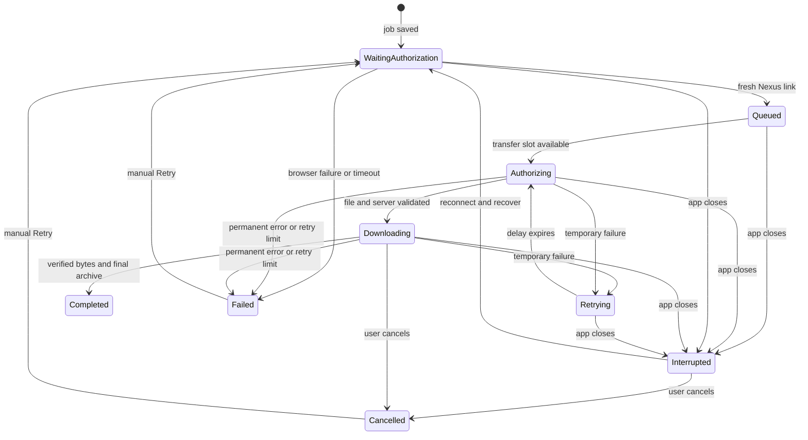

# Download queue behavior and recovery

NexusM saves an accepted download before starting its browser authorization or archive transfer. The job records the exact game, mod and file IDs, its queue order, and its destination folder. Updating the app keeps the queue in `%LOCALAPPDATA%\NexusM`; replacing the application files does not replace this data.

## Configuration

Open **Settings → Download queue**.

| Setting | Default | Allowed values | Behavior |
| --- | --- | --- | --- |
| Parallel downloads | 2 | 1–4 | Maximum simultaneous archive transfers. Each file uses one stream. |
| Automatic retries | 3 | 0–10 | Retries after the initial transfer attempt; the default allows four attempts. |
| Network timeout | 90 seconds | 15–600 seconds | Bounds stalled requests and periods without transfer progress, rather than the total duration of a large download. |
| Retry delay | 2 seconds | 1–60 seconds | Initial delay, doubled after consecutive transient failures and capped at five minutes. A server's longer `Retry-After` takes precedence. |
| Resume unfinished downloads on startup | Enabled | Enabled or disabled | Requeues interrupted jobs after connecting; cancelled and failed jobs remain available for manual retry. |

Transport settings are validated and saved together. Changes that would replace a running downloader are refused while downloads or authorization are active. Editing the fields preserves the draft across progress updates. Each queued job retains its own folder, so changing the global folder does not redirect an unfinished partial file.

Nexus browser authorization runs one file at a time while archive transfers can run in parallel. This keeps sign-in and browser checks manageable. Nexus account restrictions, countdowns, and server limits still apply.

## State transitions

Completed archives are counted as downloaded. Waiting, transferring, failed and interrupted jobs remain separate entries. The visible summary reports completed, active and total entries from the same queue state.

## Closing, crashing, or updating

| Point of interruption | On the next launch |
| --- | --- |
| Waiting for the free-account countdown or sign-in | The saved file ID is reauthorized after connecting. Old signed links are not saved or replayed. |
| Waiting for a transfer slot | The job returns in its saved queue order. |
| Downloading | The original partial file is checked and resumed when the server accepts a matching range request. |
| Waiting between automatic retries | The job is retained and requests fresh authorization; a new recovery session has a fresh bounded attempt budget. |
| Archive finished, but queue completion was not saved | A durable finalization receipt identifies the verified archive so startup can reconcile completion without downloading it again. |
| Explicitly cancelled | It stays cancelled. Manual Retry can use the retained partial file. |
| Failed after exhausting retries, an unavailable file, or a disk error | It stays failed with its reason and recent events. Manual Retry is available. |
| Account or network unavailable | Jobs remain saved. Reconnecting can recover them; they are not silently removed. |

Shutdown records recovery intent before cancelling network tasks. State updates use an atomic replacement and retain the previous state as `state.json.bak`. If the main file is unreadable, NexusM attempts the backup and preserves unreadable originals. A queue write failure prevents a new job from starting without a durable record. Existing jobs retain their prior records, and persistence errors are reported.

There is no automatic 500-entry truncation. Unfinished jobs, failures and cancellations remain until the user explicitly clears them. **Clear list** is an intentional removal of entries and stops recovery for removed jobs; it keeps archives, partial files and successful per-file history.

If both state files are damaged or the disk cannot store them, automatic recovery cannot reconstruct unknown records. Preserved unreadable copies and exported library backups are recovery sources; the app does not claim that an unreadable file is a successfully restored queue.

## Retry and timeout policy

| Condition | Result |
| --- | --- |
| Network interruption, request/read timeout, HTTP 408, HTTP 429, or HTTP 5xx | Retry within the configured budget with exponential delay. Fetch fresh CDN links on each attempt. |
| Server supplies `Retry-After` up to one hour | Wait at least that long before retrying. |
| Server requests a pause longer than one hour | Keep a failed job and its suggested retry time rather than automatically retrying early. |
| Expired authorization, HTTP 401/403, or an HTML login page instead of an archive | Keep a failed job. Retry obtains fresh website authorization. |
| Deleted or unavailable file | Keep a failed job; choose an available file from the mod page. |
| Disk access, insufficient space, or write failure | Keep a failed job and its partial file; fix the destination before retrying. |
| Authorization page stalls or never hands over a link | Fail that entry after five minutes, or twice the configured network timeout if longer, up to twenty minutes. The next queued authorization can proceed. |
| User cancels | Stop the job without treating it as a transient failure or automatically restarting it. |

A slow download that continues receiving bytes is allowed to exceed the network timeout in total duration. Timeouts also cover stalled body reads that ignore cancellation, so a stuck connection cannot keep a transfer slot forever.

Download attempts control the retry budget for their API and archive requests. Library update checks retain their separate API retry behavior. A single failed file does not discard unrelated queued files.

## Partial files and completion

Partial filenames contain the Nexus game, mod and file IDs. Resume metadata contains source validators and expected length, without API keys or signed URLs. A range response must start at the retained offset and have a consistent total and source validator. If the server ignores the range, the file is restarted from byte zero. A changed source or unusable resume range is handled without appending incompatible bytes.

Before the final archive rename, an atomic receipt records the verified partial file's identity and intended destination. Completion recovery requires the matching identity and job IDs within that destination folder. A filename collision selects another name; existing archives are not overwritten. The receipt is acknowledged only after the completed queue/history record is saved.

Resuming bytes depends on the source server's range and validator support. Queue recovery preserves the job even when a transfer must restart from zero. Nexus also documents that traditional download links expire and its website may need to request new ones: [Nexus resumable download guidance](https://help.nexusmods.com/article/170-resumable-downloads).

## Diagnostics

Each entry's **Download log** shows its recent events: queue admission, authorization, attempts, retry reasons, completion, cancellation and recovery. Logs contain timestamps and error codes, retain the latest 40 events per job, and are saved with the queue. Live progress updates preserve an open log and keyboard focus.

The events are intended for troubleshooting, rather than a permanent audit trail. Older events are trimmed. Download history and destinations remain personal data in the local state and its backup; API keys and signed URLs are excluded from queue diagnostics.

Useful evidence when reporting a failed download is its error code, attempt number, and the final few events. For rate limits, wait until the server allows requests again; Nexus explains its limits in [API rate-limit guidance](https://help.nexusmods.com/article/105-i-have-reached-a-daily-or-hourly-limit-api-requests-have-been-consumed-rate-limit-exceeded-what-does-this-mean).

## Verification

All download fixtures use synthetic accounts, HTTP handlers and archive bytes. They do not access your Nexus session or download real mods.

| Suite | Coverage |
| --- | --- |
| `Test-Backend.ps1` | Actual concurrency bound, independent files, retry budgets, permanent failures, cancellation, hung requests/streams, source validation, filename collisions and finalization receipts. |
| `Test-Controller.ps1` | Large queues, durable settings, original folders, recovery order, offline/cancelled jobs, state backup recovery, admission write failures, and bounded redacted events. |
| `Test-QueueBrowser.ps1` | Authorization deduplication, cancellation, deadlines, mismatched links and late timeouts. |
| `Test-QueueRestart.ps1` | A controlled child process is forcibly stopped during a synthetic download; restart retains queued jobs and resumes the partial bytes. |
| `Test-BatchDownload.ps1` | Batch admission, eligibility, duplicate prevention and failed authorization setup. |
| `Test-DownloadUpdates.ps1` | Replacement archives keep their previous file until success; stale or abandoned deletion intent cannot remove an unrelated archive. |
| `Test-UI.ps1` | Settings validation and drafts, attempts, countdowns, logs, stable focus, and completed/active/total counts. |

The integration checks also exercise startup, cleanup and the other existing offline suites. Generated builds, synthetic archives, profiles and reports stay outside commits.
